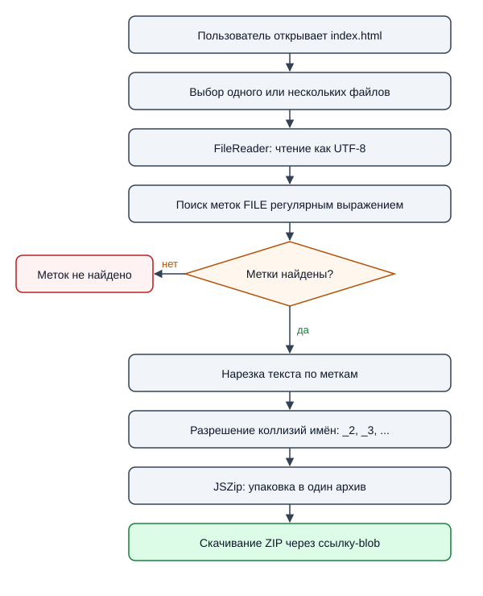

# Разделитель текста по меткам

Версия v1.4.

## Назначение и возможности

Одностраничный HTML-инструмент для нарезки одного или нескольких текстовых файлов на отдельные plain-text файлы по меткам вида `<!-- FILE: имя_файла -->`. Результат упаковывается в ZIP-архив и скачивается одним действием.

Возможности:

- загрузка одного или нескольких исходных текстовых файлов;
- поиск меток вида `<!-- FILE: имя -->` (регистр ключевого слова `FILE` не важен, допускаются пробелы вокруг двоеточия);
- нарезка содержимого между метками в отдельные файлы;
- автоматическое разрешение коллизий имён — при совпадении имён из разных входных файлов к последующим добавляется суффикс `_2`, `_3` и т. д.;
- упаковка всех найденных фрагментов из всех загруженных файлов в один ZIP;
- отчёт по каждому входному файлу: сколько найдено фрагментов, были ли ошибки;
- вся обработка — локально в браузере, без отправки на сервер.

## Адрес репозитория

Проект опубликован: [text-separator](https://github.com/butko/text-separator).

## Схема работы

## Файлы проекта

| Файл | Роль |
|------|------|
| [index.html](index.html) | Основной и единственный файл инструмента: разметка и вся логика на JavaScript |
| [scheme.svg](scheme.svg) | Схема работы |
| [readme.md](readme.md) | Этот документ |
| [rules-project.md](rules-project.md) | Правила и специфика проекта |

Универсальные правила работы над проектами: [rules-common.md в репозитории LLM-rules](https://github.com/butko/LLM-rules/blob/main/project/rules-common.md).

## Требования и установка

Требования:

- современный браузер: Chrome, Firefox, Edge, Safari последних версий;
- доступ в интернет при первом запуске — для загрузки JSZip 3.10.1 с CDN `cdnjs.cloudflare.com` (не относится к онлайн-версии: она уже развёрнута).

### Запуск онлайн

Инструмент развёрнут на GitHub Pages. Открыть в браузере:

https://butko.github.io/text-separator/index.html

Установка не требуется, скачивать ничего не нужно.

### Локальный запуск

- склонировать репозиторий или скачать `index.html` из него;
- открыть файл в браузере — двойным кликом или через «Файл → Открыть» в браузере.

Установка зависимостей и локальный веб-сервер не требуются.

Работа без интернета (офлайн-режим): скачать `jszip.min.js` с сайта проекта JSZip и положить рядом с `index.html`, затем в `index.html` заменить в теге `script` адрес CDN на относительный путь `jszip.min.js`.

## Устранение неполадок

**«Меток не найдено».** Проверьте, что в тексте есть строки точно в формате `<!-- FILE: имя -->` — с двумя дефисами по краям, латинским словом `FILE` и пробелами вокруг имени. Регистр `FILE` не важен, лишние пробелы внутри метки допускаются. Если метка написана по-русски («ФАЙЛ») или без `<!--` / `-->`, скрипт её не найдёт.

**Кириллица в именах файлов.** Имена фрагментов берутся из метки как есть. Если исходный файл в кодировке, отличной от UTF-8 (например, Windows-1251), кириллические имена могут сохраниться с искажениями. Пересохраните исходный текст в UTF-8 перед загрузкой.

**Файл большой (сотни мегабайт).** Обработка идёт целиком в памяти браузера. Для файлов свыше ~200–300 МБ возможны замедление и отказ браузера. При регулярной работе с большими текстами — уменьшите размер входного файла или дождитесь потоковой доработки.

**Скачивание не начинается.** Проверьте, что браузер не блокирует всплывающие окна и не спрашивает подтверждение на множественные загрузки (некоторые браузеры считают ZIP с сотнями файлов подозрительным). Разрешите загрузку для страницы.

**ZIP-архив пуст или повреждён.** Откройте консоль браузера (F12 → Console) и посмотрите текст ошибки. Частая причина — блокировка JSZip расширением-антитрекером; отключите расширение для этой страницы и повторите.

**Онлайн-версия недоступна.** GitHub Pages может быть временно недоступен или заблокирован в вашей сети. В этом случае используйте локальный запуск (см. «Локальный запуск»).

## Безопасность

- Все данные обрабатываются локально в браузере. На сервер ничего не отправляется — ни при локальном, ни при онлайн-запуске.
- Сетевой запрос выполняется только один — за библиотекой JSZip с CDN `cdnjs.cloudflare.com`. Текст, метки и имена файлов в нём не передаются.
- Скачанный ZIP формируется в памяти браузера и не сохраняется нигде, кроме папки загрузок пользователя.
- Если политика безопасности требует полностью отключить сетевые запросы, используйте офлайн-режим (см. «Требования и установка»).

## Лицензия

Распространяется по лицензии [Creative Commons Attribution-ShareAlike 4.0](https://creativecommons.org/licenses/by-sa/4.0/deed.ru).